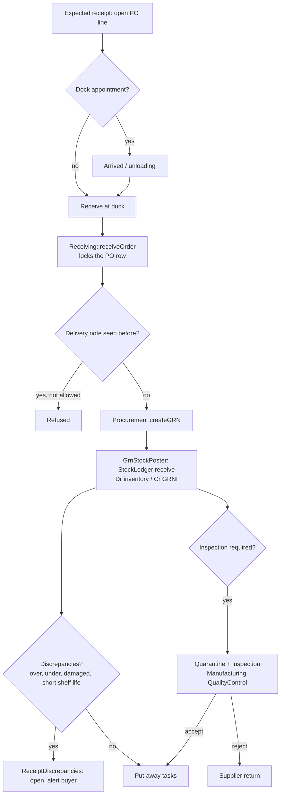
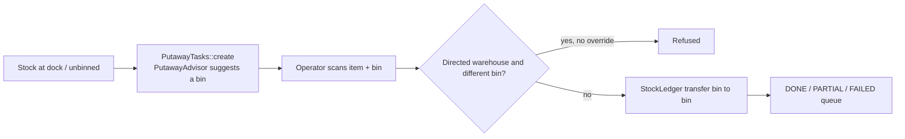
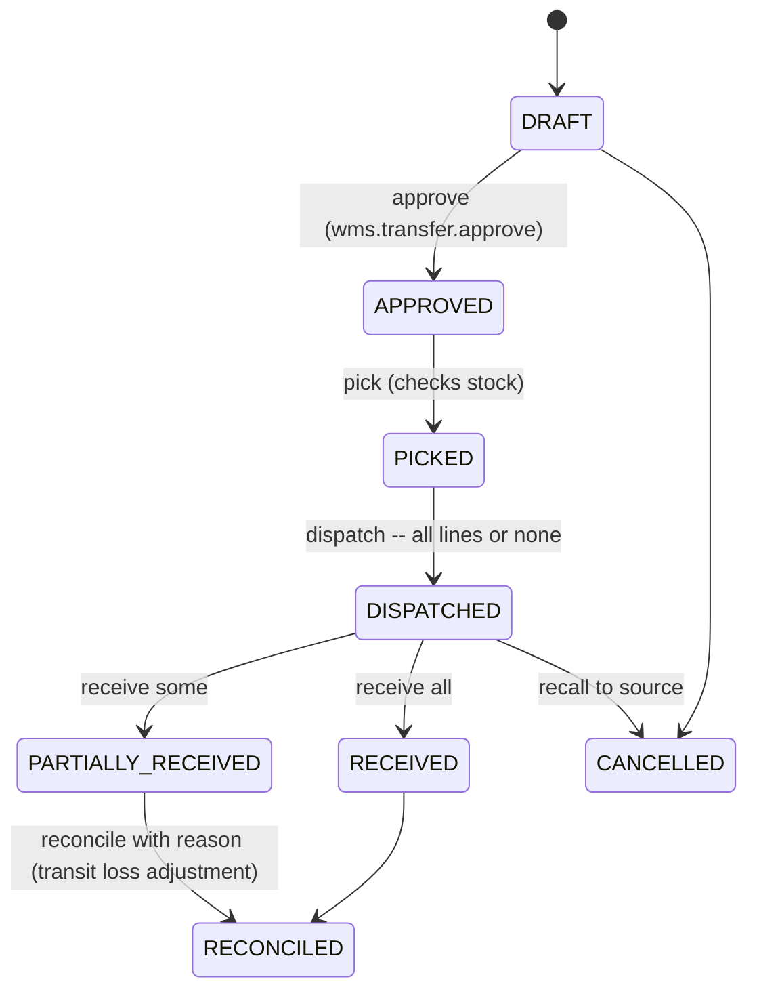
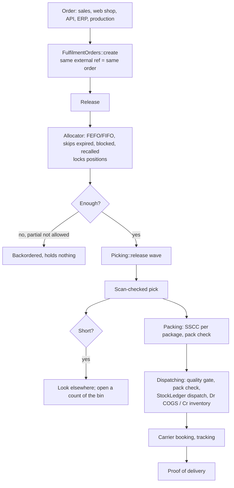
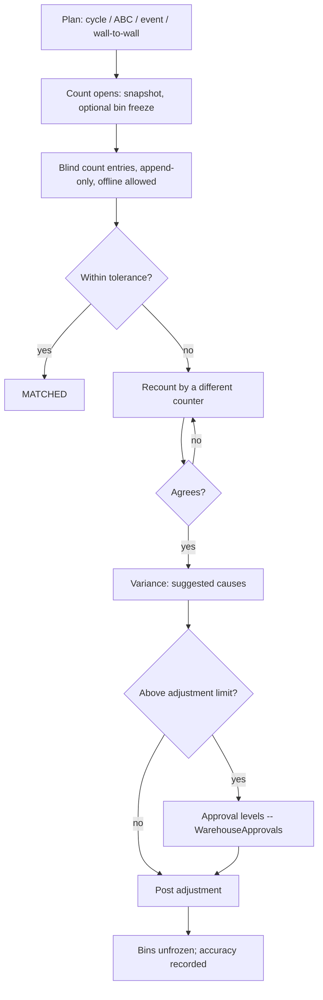
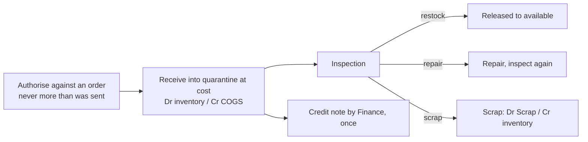
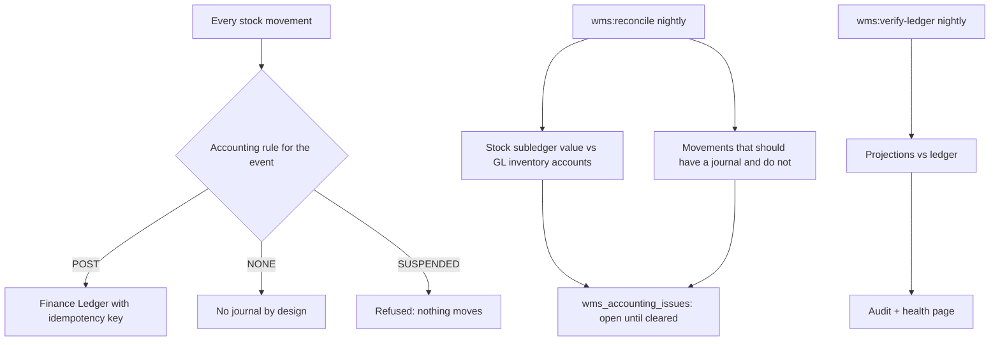

# 3. Workflow diagrams

Mermaid diagrams; each names the service that does the work.

## Receiving (WMS-030..035)



## Put-away (WMS-040..043)



## Transfers (WMS-052)



## Picking, packing and dispatch (WMS-060..066)



## Stocktake (WMS-070..073)



## Customer returns (WMS-080..083)



## Accounting reconciliation (WMS-100..104)



## Approvals (WMS-191)

```mermaid
sequenceDiagram
    participant R as Requester
    participant A as WarehouseApprovals
    participant L1 as Level 1 approver
    participant L2 as Level 2 approver / delegate
    R->>A: request (adjustment, revaluation)
    A->>A: lay out levels by value (policy)
    L1->>A: approve (not the requester)
    A-->>L2: due by deadline; escalate if overdue
    L2->>A: approve (different person; delegate recorded as on behalf of)
    A->>R: posted
```
